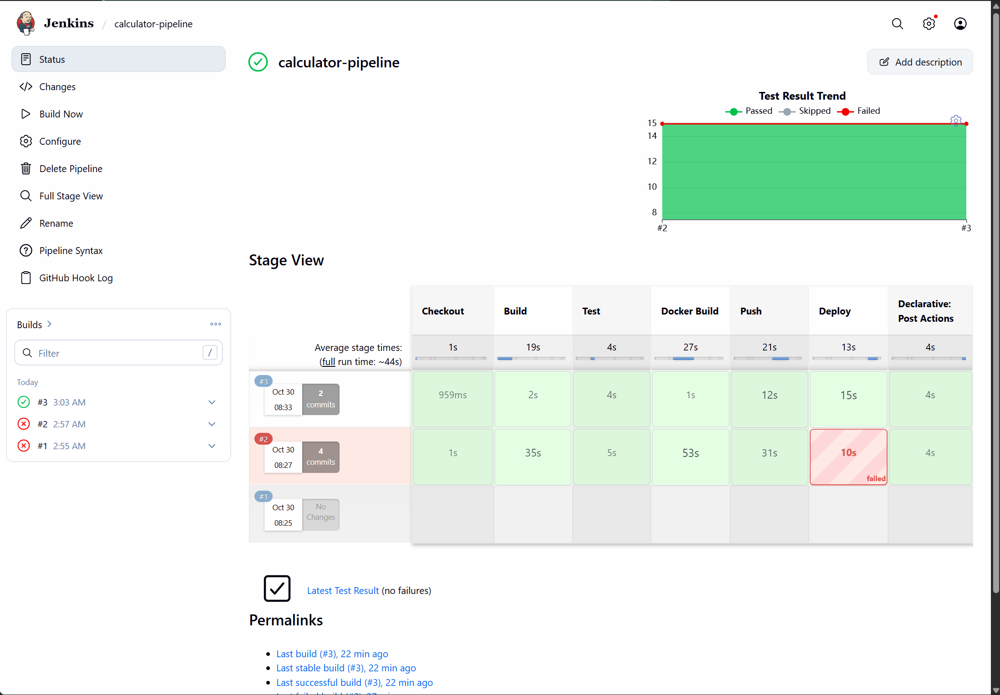
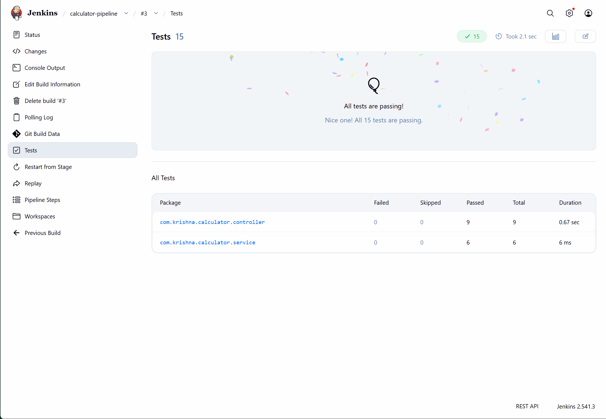
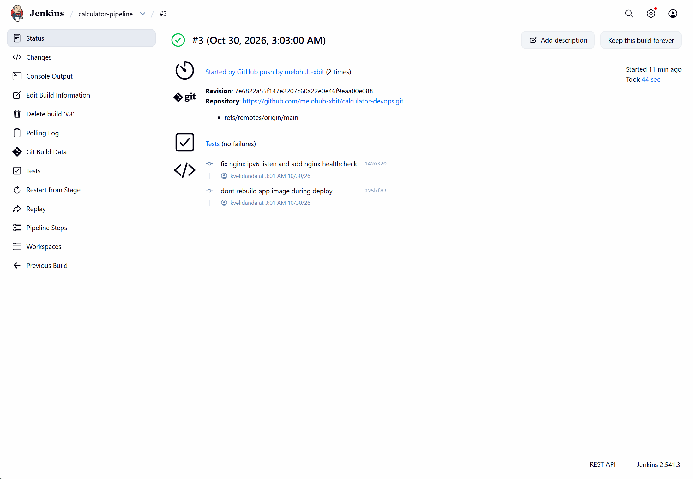
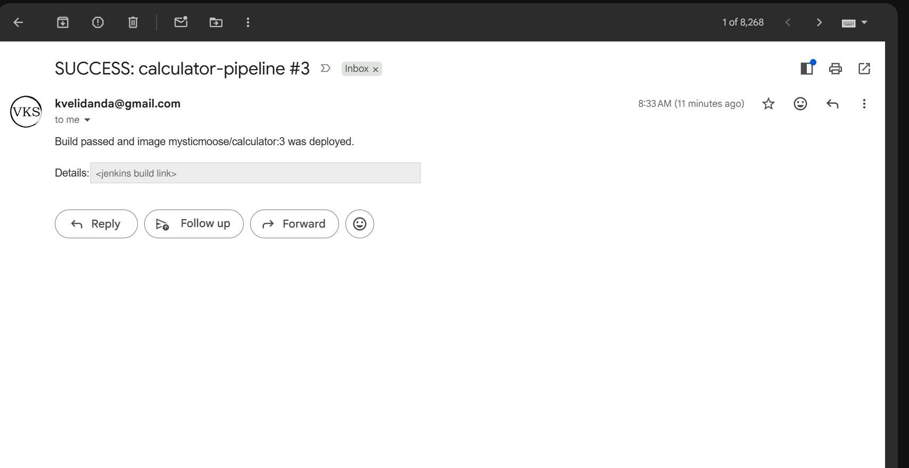
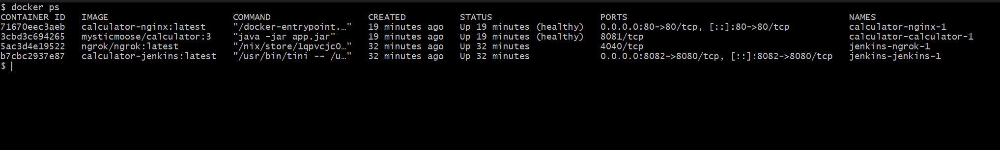
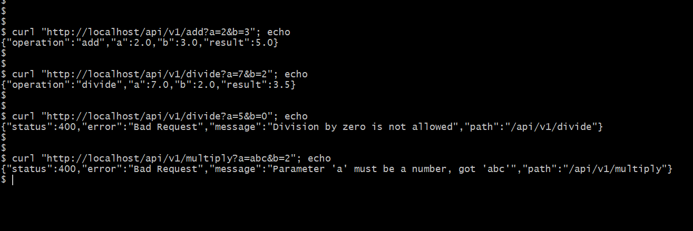
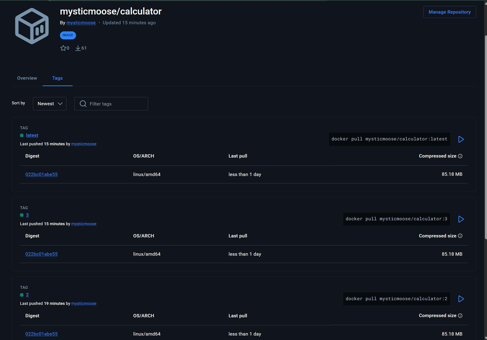

# calculator-devops

Simple calculator REST API in Spring Boot, with a CI/CD pipeline around it
(Jenkins + Docker + Docker Compose). Mini project for CSE 816 - Software Production Engineering.

## Requirements

- JDK 17
- Maven 3.9+

## Build, test and run

```
mvn clean package     # build the jar (also runs tests)
mvn test              # only run tests, reports go to target/surefire-reports
java -jar target/calculator.jar
```

App runs on port 8081. Health check: http://localhost:8081/actuator/health

## Docker

Multi-stage build - maven image builds the jar, then only the jar is copied into a small JRE image.

```
docker build -t calculator .
docker run -d -p 8081:8081 --name calculator calculator
```

## Docker Compose

Runs the app behind an nginx reverse proxy. Only nginx is published (port 80), the app
container is reachable only inside the `calc-net` network.

```
docker compose up -d --build
docker compose ps
curl "http://localhost/api/v1/add?a=2&b=3"
docker compose down
```

The app has a healthcheck on `/actuator/health` and nginx only starts once the app is healthy.
`IMAGE_NAME` and `IMAGE_TAG` can be set to run a specific image (used by Jenkins).

## CI/CD with Jenkins

Jenkins runs in its own container (`jenkins/`), with maven and the docker cli installed. It uses the
host docker through the mounted socket. Plugins, credentials, email and the pipeline job are all set up
with configuration-as-code (`jenkins/casc.yaml`), so there is no setup wizard. ngrok runs next to it
so GitHub can reach the webhook.

Setup:

```
cp .env.example .env      # fill in the values
docker compose -f jenkins/docker-compose.yml --env-file .env up -d --build
```

Jenkins is on http://localhost:8082 (user `admin`). On linux set `DOCKER_GID` to the id of the
`docker` group so jenkins can use the socket.

GitHub webhook: `https://<ngrok-domain>/github-webhook/`, push events, content type json.

Pipeline stages (`Jenkinsfile`):

1. Checkout - pull the code
2. Build - `mvn clean package -DskipTests`
3. Test - `mvn test`, publish JUnit reports
4. Docker Build - build `mysticmoose/calculator:<build number>` and `:latest`
5. Push - push both tags to Docker Hub using the `dockerhub` credential
6. Deploy - `docker compose up -d --wait`, then call health and an endpoint through nginx

An email is sent on success and on failure.

Docker Hub image: https://hub.docker.com/r/mysticmoose/calculator

## API

All endpoints take two numbers `a` and `b` as query params.

| Operation | Endpoint |
|-----------|----------|
| Add       | `GET /api/v1/add?a=2&b=3` |
| Subtract  | `GET /api/v1/subtract?a=5&b=1` |
| Multiply  | `GET /api/v1/multiply?a=4&b=2.5` |
| Divide    | `GET /api/v1/divide?a=7&b=2` |
| Health    | `GET /actuator/health` |

Example:

```
$ curl "http://localhost:8081/api/v1/add?a=2&b=3"
{"operation":"add","a":2.0,"b":3.0,"result":5.0}
```

Errors (missing param, not a number, divide by zero) return HTTP 400:

```
$ curl "http://localhost:8081/api/v1/divide?a=5&b=0"
{"status":400,"error":"Bad Request","message":"Division by zero is not allowed","path":"/api/v1/divide"}
```

## Screenshots

Pipeline stage view (build #2 failed at Deploy, fixed in #3):



Test results published in Jenkins:



Build started by the GitHub webhook:



Email notification:



Running containers:



API responses through nginx:



Image on Docker Hub:


